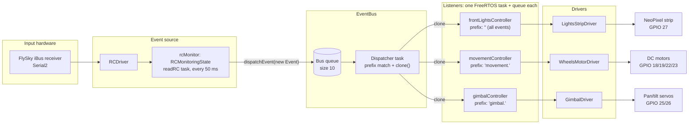
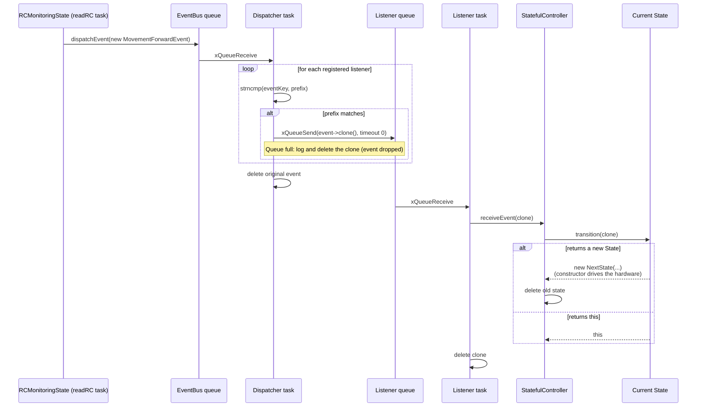
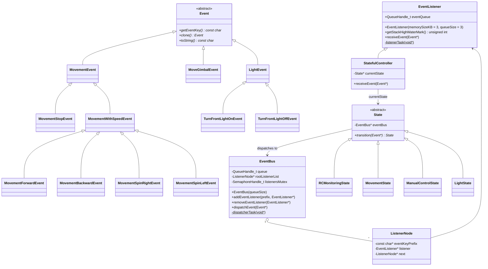
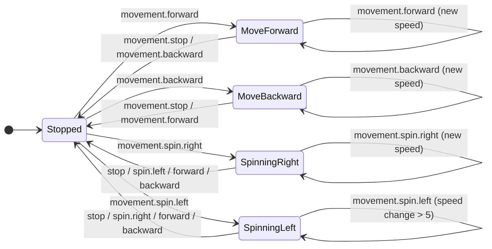
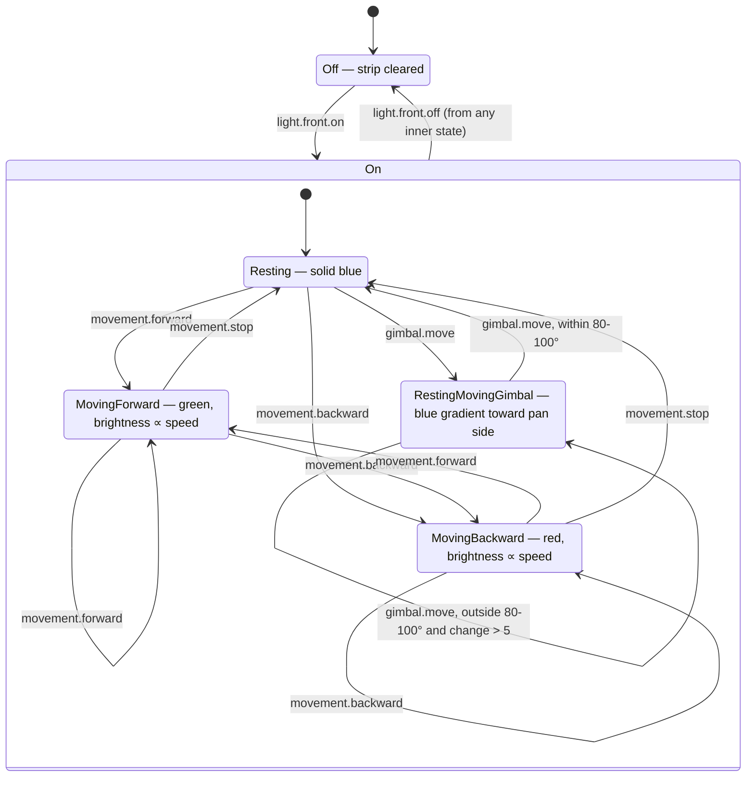
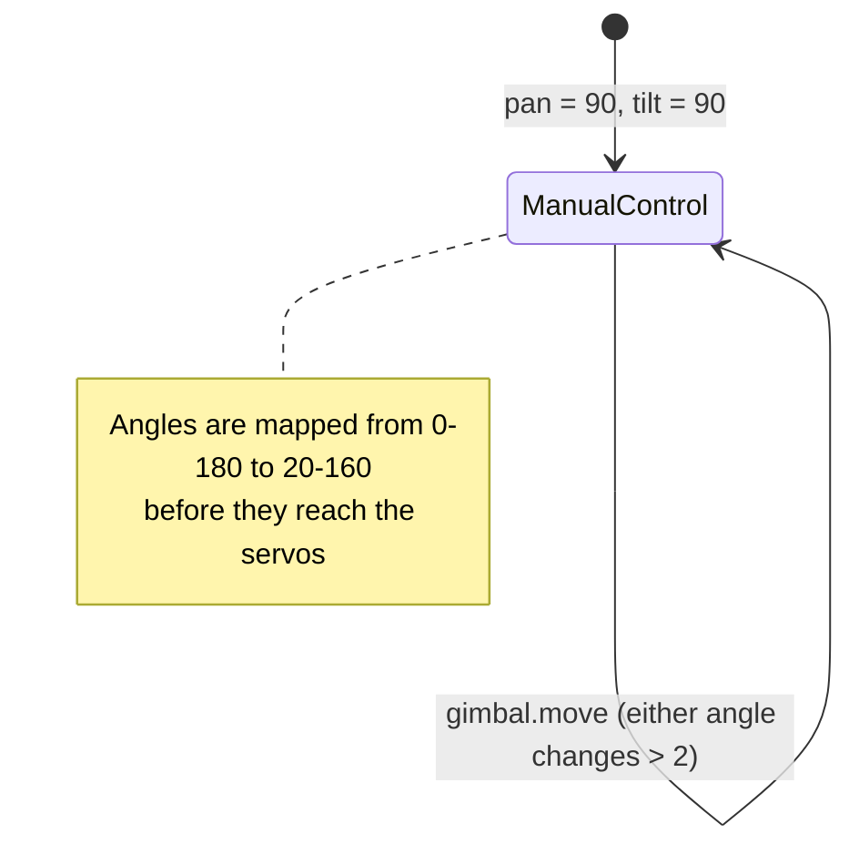

# Architecture

TankEsp32 is event-driven. One component reads the RC receiver and publishes events to an `EventBus`. Each subsystem (movement, gimbal, front lights) has its own `StatefulController`. Each controller holds a state machine, receives events whose key matches its prefix, and drives its hardware through a driver.

The framework classes are defined in [`lib/EventDrivenStates`](../lib/EventDrivenStates/src/EventDrivenStates.h). The objects are wired together in [`src/main.cpp`](../src/main.cpp).

## Components and event flow

All controllers are active in `main.cpp`.

## Event lifecycle and ownership

Events are heap-allocated and short-lived. The bus deletes the original after fan-out. Each listener receives its own clone and deletes it after `receiveEvent()` returns. If `transition()` returns a different state, the controller deletes the old one.

## Framework classes

## Event keys

| Key | Class | Payload | Emitted when |
|---|---|---|---|
| `movement.forward` | `MovementForwardEvent` | horizontal, vertical speed | throttle > 10 |
| `movement.backward` | `MovementBackwardEvent` | horizontal, vertical speed | throttle < -10 |
| `movement.spin.right` | `MovementSpinRightEvent` | speed | throttle in ±10 and turn > 10 |
| `movement.spin.left` | `MovementSpinLeftEvent` | speed | throttle in ±10 and turn < -10 |
| `movement.stop` | `MovementStopEvent` | none | both sticks centred |
| `gimbal.move` | `MoveGimbalEvent` | horizontal, vertical angle | tilt or pan changed |
| `light.front.on` / `light.front.off` | `TurnFrontLight{On,Off}Event` | none | lights switch toggled |

`RCMonitoringState` emits events only when channel values change. RC input is continuous, so an occasional dropped event is accepted: the next change supersedes it.

## State machines

### Movement ([`MovementState.h`](../src/states/MovementState.h))

The constructor of each state drives the motors. Changing direction (including spin → forward/backward) always passes through `Stopped`; the next forward/backward event starts the new move. A self-transition builds a new state with the new speed.

### Front lights ([`FrontLighstState.h`](../src/states/FrontLighstState.h))

This controller listens to every event (prefix `""`) because it reacts to movement and gimbal events as well as light events. `MovingForward` and `MovingBackward` share the transition logic in `FrontLightMovingState`.

`On` only groups the states for readability. In the code, each inner state handles `light.front.off` on its own.

### Gimbal ([`GimbalState.h`](../src/states/GimbalState.h))

### RC monitor ([`RCState.h`](../src/states/RCState.h))

`RCMonitoringState` is not wrapped in a `StatefulController` and is not registered on the bus: it only produces events. Its constructor starts the `readRC` task, which reads the receiver and calls `dispatchEvent` directly. It lives for the whole run and must never be deleted, because the task keeps using it.

Driving modes, such as the planned autonomous driving, should be a state machine in their own controller that reacts to events. They don't belong in the RC monitor.
